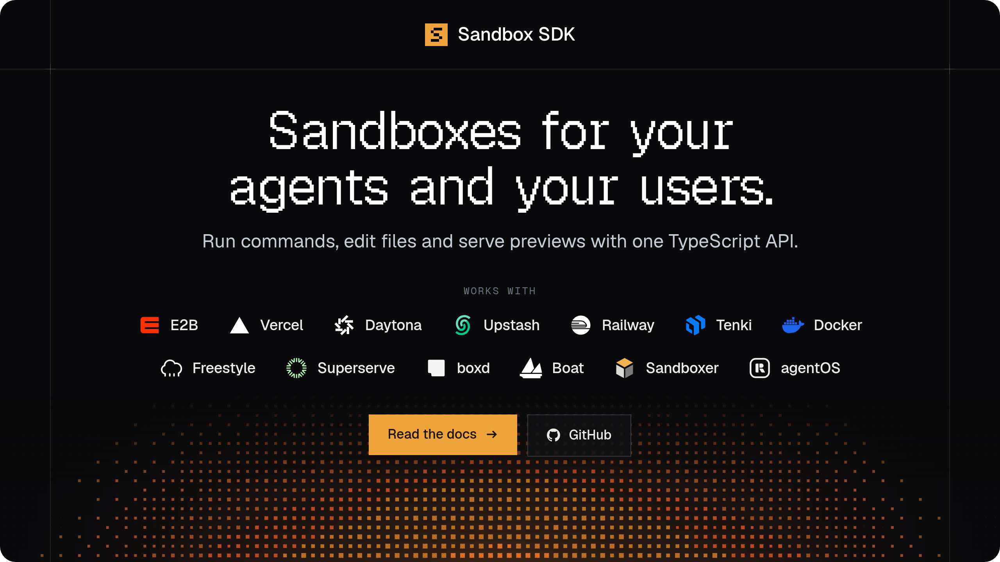

<p align="center">
  <a href="https://sandbox-sdk.app">
    
  </a>
</p>

<p align="center">
  <a href="https://sandbox-sdk.app/docs">Docs</a> ·
  <a href="https://sandbox-sdk.app/docs/getting-started/quickstart">Quickstart</a> ·
  <a href="https://sandbox-sdk.app/docs/providers">Providers</a> ·
  <a href="https://www.npmjs.com/package/@opencoredev/sandbox-sdk">npm</a> ·
  <a href="./packages/sdk/CHANGELOG.md">Changelog</a>
</p>

Sandbox SDK gives your server-side TypeScript one API for creating sandboxes, running commands, editing files and serving previews. The same code runs on 11 cloud providers, including E2B, Daytona, Vercel Sandbox and Upstash Box, or in Docker on your own machine. Switching providers means changing one import.

> [!NOTE]
> Coming from 0.2? 1.0 changes the API. [Upgrade from 0.2](https://sandbox-sdk.app/docs/upgrade-from-0-2) walks through each change.

## Install

```sh
npm install @opencoredev/sandbox-sdk
```

It needs Node.js 22+ or Bun 1.3+. Each provider's own SDK is an optional peer, so you install only the ones you use, such as `npm install e2b`.

## Quickstart

This runs with no account and no Docker. `memory()` is an in-process fake sandbox for trying the API and for tests.

```ts
import { createSandbox } from "@opencoredev/sandbox-sdk";
import { memory } from "@opencoredev/sandbox-sdk/memory";

await using box = await createSandbox(memory());

await box.files.write("hello.txt", "hello from the sandbox\n");
const result = await box.run("cat hello.txt");
console.log(result.ok, result.stdout); // true "hello from the sandbox\n"
```

For a real Linux machine, swap the provider. Nothing else changes.

```ts
import { createSandbox } from "@opencoredev/sandbox-sdk";
import { e2b } from "@opencoredev/sandbox-sdk/e2b";

// Reads E2B_API_KEY from the environment. Run `npm install e2b` first.
await using box = await createSandbox(e2b());

await box.files.write("hello.py", "print('hello from the sandbox')");
const result = await box.run("python3 hello.py");
console.log(result.stdout); // "hello from the sandbox\n"
```

`await using` deletes a sandbox created without a `key` when the scope ends, even if your code throws. With a `key`, it calls `close()` and leaves the sandbox running; call `destroy()` when you are done with it. A command that exits non-zero resolves with `ok: false` instead of throwing.

## What a sandbox can do

| Task                                          | API                                                             |
| --------------------------------------------- | --------------------------------------------------------------- |
| Run a command, stream its output, time it out | `box.run("npm test")`, `` box.$`git checkout ${branch}` ``      |
| Read, write, edit and search files            | `box.files.write()`, `read()`, `edit()`, `search()`, `upload()` |
| Start a dev server and wait until it answers  | `box.start("npm run dev", { ready: { port: 3000 } })`           |
| Get a URL for a port                          | `box.preview(3000)`                                             |
| Clone, commit and push without leaking tokens | `box.git.clone()`, `commit()`, `push()`                         |
| Pause, resume and snapshot                    | `box.pause()`, `box.resume()`, `box.snapshot()`                 |
| Find the same sandbox on the next request     | `createSandbox(provider, { key: "user:123" })`                  |

Pause and snapshot exist only on providers that support them, and TypeScript knows which ones do. Every failure is a `SandboxError` with a `code` you can branch on. The [package README](./packages/sdk/README.md) covers the full API.

## Give an agent a sandbox

`sandboxTools` turns a sandbox into tools an agent can call: `run`, `read_file`, `write_file`, `edit_file`, and background process control. Secrets you register never reach the model.

This example uses the AI SDK and E2B. Install them next to the SDK:

```sh
npm install ai zod e2b
```

The model string goes through the Vercel AI Gateway, so set `AI_GATEWAY_API_KEY` on your server along with `E2B_API_KEY`. Any AI SDK provider works in its place.

```ts
import { generateText, stepCountIs } from "ai";
import { createSandbox } from "@opencoredev/sandbox-sdk";
import { sandboxTools } from "@opencoredev/sandbox-sdk/ai";
import { e2b } from "@opencoredev/sandbox-sdk/e2b";

await using box = await createSandbox(e2b());
await box.git.clone("https://github.com/opencoredev/sandbox-sdk", { dir: "app", depth: 1 });

const { text } = await generateText({
  model: "anthropic/claude-opus-5-5",
  tools: sandboxTools(box, { root: "/workspace/app" }),
  stopWhen: stepCountIs(20),
  prompt: "Run the tests and fix the first failure.",
});
```

The same tools come for Mastra (`/mastra`), the OpenAI Agents SDK (`/openai`) and any other framework (`/tools`). See [agent tools](https://sandbox-sdk.app/docs/reference/agent-tools) for the options.

## Providers

| Provider                                                               | Import                                | Install                       |
| ---------------------------------------------------------------------- | ------------------------------------- | ----------------------------- |
| [E2B](https://sandbox-sdk.app/docs/providers/e2b)                      | `@opencoredev/sandbox-sdk/e2b`        | `e2b`                         |
| [Daytona](https://sandbox-sdk.app/docs/providers/daytona)              | `@opencoredev/sandbox-sdk/daytona`    | `@daytonaio/sdk`              |
| [Vercel Sandbox](https://sandbox-sdk.app/docs/providers/vercel)        | `@opencoredev/sandbox-sdk/vercel`     | `@vercel/sandbox`             |
| [Upstash Box](https://sandbox-sdk.app/docs/providers/upstash)          | `@opencoredev/sandbox-sdk/upstash`    | `@upstash/box`                |
| [Railway](https://sandbox-sdk.app/docs/providers/railway)              | `@opencoredev/sandbox-sdk/railway`    | `railway`                     |
| [Tenki](https://sandbox-sdk.app/docs/providers/tenki)                  | `@opencoredev/sandbox-sdk/tenki`      | `@tenkicloud/sandbox`         |
| boxd                                                                   | `@opencoredev/sandbox-sdk/boxd`       | `@boxd-sh/sdk`                |
| Freestyle                                                              | `@opencoredev/sandbox-sdk/freestyle`  | `freestyle`                   |
| Superserve                                                             | `@opencoredev/sandbox-sdk/superserve` | `@superserve/sdk`             |
| Boat                                                                   | `@opencoredev/sandbox-sdk/boat`       | `@boatdev/sdk`                |
| Sandboxer                                                              | `@opencoredev/sandbox-sdk/sandboxer`  | `@boatdev/sdk`                |
| [Docker on your machine](https://sandbox-sdk.app/docs/providers/local) | `@opencoredev/sandbox-sdk/local`      | nothing; needs Docker running |
| [agentOS](https://sandbox-sdk.app/docs/providers/agentos)              | `@opencoredev/sandbox-sdk/agentos`    | `@rivet-dev/agentos-core`     |
| Memory, for tests                                                      | `@opencoredev/sandbox-sdk/memory`     | nothing                       |

[Compare providers](https://sandbox-sdk.app/docs/providers) for credentials, capabilities and preview rules. To add your own, implement `Provider` from `@opencoredev/sandbox-sdk/provider` and test it with `runConformance` from `@opencoredev/sandbox-sdk/testing`.

## Repository

| Path                             | What it holds                                                                            |
| -------------------------------- | ---------------------------------------------------------------------------------------- |
| [`packages/sdk`](./packages/sdk) | The `@opencoredev/sandbox-sdk` package                                                   |
| [`examples`](./examples)         | Runnable examples, starting with [getting-started](./examples/getting-started)           |
| [`bench`](./bench)               | The provider benchmark harness                                                           |
| [`apps/docs`](./apps/docs)       | The documentation site                                                                   |
| [`apps/web`](./apps/web)         | The landing page, and the logo and social images in [`apps/web/brand`](./apps/web/brand) |
| [`docs`](./docs)                 | The 1.0 design spec and provider reference notes                                         |

[EARLY_ACCESS.md](./EARLY_ACCESS.md) has per-provider setup and known limits. Release steps are in [RELEASING.md](./RELEASING.md). Report bugs in [issues](https://github.com/opencoredev/sandbox-sdk/issues).

## License

[MIT](./LICENSE) © OpenCore
