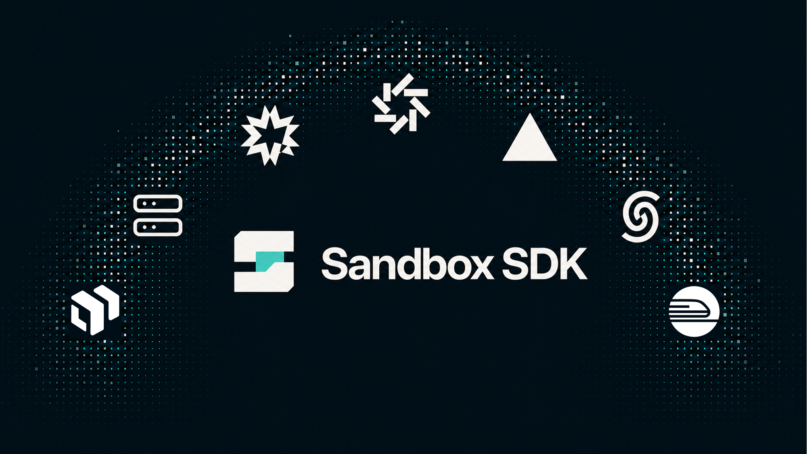

<p align="center">
  
</p>

One TypeScript API for running code in a sandbox. Write it once, then run it on E2B, Daytona, Vercel Sandbox, Upstash Box, Railway, Tenki, boxd, Freestyle, Superserve, Boat, Sandboxer, or Docker on your own machine.

> 1.0 is in beta. Install it with `@next`; `latest` is still 0.2.

```bash
npm install @opencoredev/sandbox-sdk@next
```

```ts
import { createSandbox } from "@opencoredev/sandbox-sdk";
import { memory } from "@opencoredev/sandbox-sdk/memory";

await using box = await createSandbox(memory());
await box.files.write("hello.txt", "hello\n");
console.log((await box.run("cat hello.txt")).stdout);
```

`memory()` needs no account. Swap it for `e2b()`, `local()`, or any other provider and the rest stays the same.

- [Package README](./packages/sdk/README.md): install, providers and their capabilities, the full API, errors, and agent tools.
- [Early access notes](./EARLY_ACCESS.md): installing the beta from the `next` tag, per-provider setup, and known limitations.
- [Getting-started examples](./examples/getting-started): a keyless quickstart and a provider switch driven by `SANDBOX_PROVIDER`.
- [Documentation site](https://sandbox-sdk.app/docs).

## Repository

- [`packages/sdk`](./packages/sdk): the `@opencoredev/sandbox-sdk` package.
- [`examples`](./examples): runnable examples.
- [`bench`](./bench): the provider benchmark harness.
- [`apps/docs`](./apps/docs): the documentation site.
- [`apps/web`](./apps/web): the landing page.
- [`docs`](./docs): the 1.0 design spec and provider reference notes.

Maintainer release instructions are in [RELEASING.md](./RELEASING.md).

## License

[MIT](./LICENSE) © OpenCore
