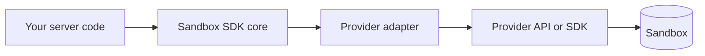

Sandbox SDK is a library that runs in your server process. It has two layers: a core that gives you the API, and one small adapter per provider that talks to that provider's HTTP API or its own SDK. There is no hosted service in between and no agent installed in the sandbox.

## The layers

1. **Your code** calls `createSandbox(provider, options)` and then methods on the handle: `run`, `files`, `start`, `preview`.
2. **The core** turns each call into a few simple primitives. It owns timeouts, output caps, streaming, the `$` tag, background processes and their logs, `files.edit`, search, `changes`, git, secret redaction, and the error format.
3. **The adapter** maps those primitives to one provider: create, find, connect, list, destroy, run one command, basic file operations, and a preview URL. It also declares which optional features the provider has.
4. **The provider's API or SDK** makes the actual network calls with your credentials. E2B, Daytona, Freestyle, Superserve, Boat, and Sandboxer adapters call the provider's HTTP API directly. Vercel, Upstash Box, Railway, Tenki, boxd, and agentOS adapters go through the provider's SDK (`@vercel/sandbox`, for example), and Local uses the Docker API.

Because almost everything lives in the core, every provider behaves the same way for the things you use most. Adding a provider means writing only the adapter. See [Write a provider](/providers/custom).

## Where state lives

Nothing important is kept in your server's memory, which is why a sandbox survives a redeploy:

| State | Where it lives |
| --- | --- |
| The sandbox's key | In the provider: a container or sandbox name, metadata, or labels |
| Your labels and the `sandbox-sdk` label | In the provider |
| Background process records and logs | Inside the sandbox, under `/tmp/.sandbox-sdk/` |
| Log cursors | Plain strings you can store anywhere |
| `changes()` checkpoints, from `trackChanges` or `mark` | Inside the sandbox, in a hidden git index. Memory keeps copies in your process. |
| Local idle and lifetime deadlines | On the Docker container |

Any server process with the same provider credentials can find a sandbox by key, list its processes, and keep reading logs from a stored cursor.

## Capabilities and failing closed

Providers differ. Some can pause, some can limit which hosts a sandbox reaches, some can set an exact machine size. Each adapter declares what it supports, and the SDK uses that in two places:

- **In TypeScript.** `pause()`, `resume()`, `snapshot()`, and `terminal()` exist on the handle's type only when the provider declares them.
- **At creation.** If you pass an option the provider can't enforce, such as a network allow list on Local, `createSandbox` throws `unsupported` before anything runs.

The SDK never hands you a sandbox that is more open than you asked for. See the [capability matrix](/reference/capabilities).

## Defaults that keep commands safe

Every command gets a timeout, a closed stdin, a non-interactive environment, and an output cap. Each `run` is a fresh shell, so a `cd` in one call doesn't leak into the next. These defaults mean a command can't hang waiting for input or flood your server with output. The full list is in [Running commands](/concepts/running-commands#defaults).

## Errors

A command that fails is a result with `ok: false`. The SDK throws only when the sandbox, the provider, or the request itself fails, and then it always throws `SandboxError` with a `code` you can branch on. Adapters translate each provider's native errors into those codes and strip credentials on the way. See [Errors](/reference/errors).
